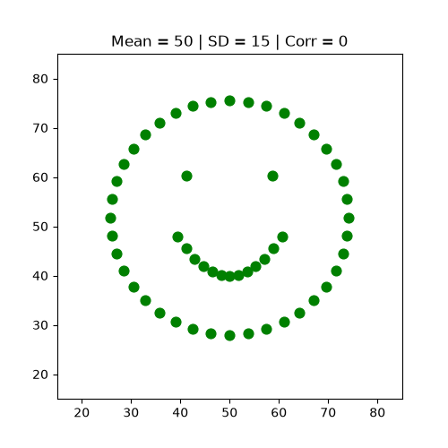

# Visualizing Hidden Structure: Why Summary Statistics Are Not Enough 😊☹️

An interactive Python animation demonstrating how two datasets with identical univariate and bivariate summary statistics can represent completely opposite visual patterns—a **Smiley Face** and a **Frown**.

---

## 🎯 Aim
To visually prove that relying solely on aggregated summary statistics (Mean, Standard Deviation, and Linear Correlation) can mask critical underlying patterns in data, highlighting why **Exploratory Data Analysis (EDA)** and **multivariate visualization** are essential before modeling or decision-making.

---

## 📖 Background
In data analysis, it is common practice to inspect a dataset using summary tables (such as pandas `.describe()` and `.corr()`). Inspired by classic statistical paradoxes like **Anscombe's Quartet** and the **Datasaurus Dozen**, this project illustrates a fundamental trap:
* **Univariate statistics** evaluate each variable in isolation, flattening individual distributions into single averages and spreads.
* **Linear correlation ($r$)** measures only straight-line relationships between two variables, remaining completely blind to symmetry and non-linear shapes.

---

## 📊 Data & Methodology
Two synthetic 2D datasets were constructed using **NumPy**, each containing **55 $(x, y)$ coordinate points**:

1. **Shared Structure (53 points):**
   * **Head:** 40 evenly spaced points arranged along a circular perimeter using trigonometric functions ($\cos\theta, \sin\theta$).
   * **Eyes:** 2 fixed coordinate points positioned symmetrically in the upper half.
2. **Divergent Feature (13 points):**
   * **Mouth:** Constructed using simple quadratic curves ($y = \pm 0.35x^2 + c$). An upward-opening parabola creates the **Smiley Face**, while a downward-opening parabola creates the **Frowny Face**.
3. **Statistical Standardization:**
   * Both datasets were transformed using **Z-score standardization** ($\frac{x - \mu}{\sigma} \times 15 + 50$) so that both shapes lock onto the exact same statistical properties:
     * **Mean of $X$ & $Y$:** `50.0`
     * **Standard Deviation of $X$ & $Y$:** `15.0`
     * **Pearson Correlation ($r$):** `0.0` (due to left-right symmetry canceling out any linear slope)
4. **Animation:**
   * Using **Matplotlib's `FuncAnimation`**, the points smoothly interpolate between both datasets across frames, exported as `smile_sad.gif`.

---

## 📋 Summary
| Metric | Smiley Face Dataset | Frowny Face Dataset |
| :--- | :---: | :---: |
| **Sample Size ($n$)** | 55 | 55 |
| **Mean ($X$ / $Y$)** | 50.0 / 50.0 | 50.0 / 50.0 |
| **Standard Deviation ($X$ / $Y$)** | 15.0 / 15.0 | 15.0 / 15.0 |
| **Pearson Correlation ($r$)** | 0.0 | 0.0 |
| **Visual Structure** | Upward Smile (Positive Curve) | Downward Frown (Negative Curve) |

---

## 💡 Inference & Key Takeaways
* **Compression Hides Reality:** Summary statistics compress multi-dimensional data into single numbers. Even when univariate distributions and correlation coefficients match to the decimal, the underlying geometry can tell opposite stories.
* **$r = 0$ Does Not Mean "No Pattern":** A zero correlation only confirms the absence of a *linear* trend—strong, structured non-linear relationships can still exist.
* **Visualize Before Modeling:** Always pair statistical summaries with visual plots (scatter plots, pair plots, distributions) during EDA to uncover hidden structures, anomalies, or non-linear interactions.

---

## 🛠️ Tech Stack & Usage
* **Language:** Python 3
* **Libraries:** `NumPy`, `Matplotlib`, `Pillow`

To run locally, open the included `.ipynb` notebook in Jupyter or VS Code and run all cells to regenerate `smile_sad.gif`.

